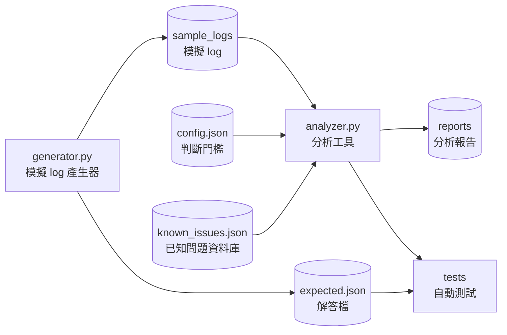
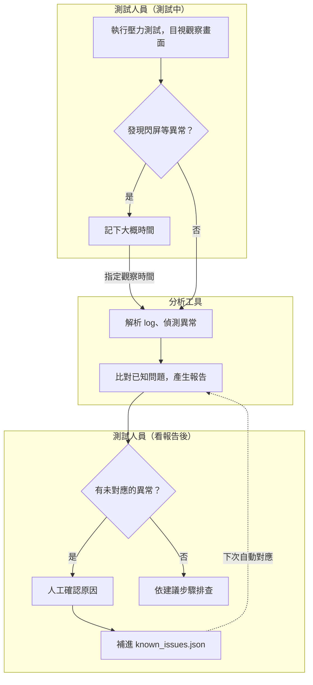
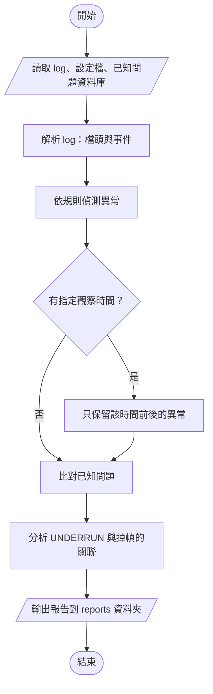

# 測試 log 異常分析工具（test-log-analyzer）

自動解析顯示器壓力測試的 log，找出異常、比對已知問題，並產生分析報告。

## 遇到的問題

在顯示器的壓力測試中，測試人員常以目視發現畫面閃爍等異常，但事後需在大量 log 中找出對應時間點與原因，相當耗時。

## 察覺到的潛在問題

- log 量越大，人工越難找、越容易漏看
- 每個人判斷標準不同，結果不一致
- 處理經驗只留在個人腦中，人員異動就會流失
- 不同產品的規格不同，判斷門檻需要能調整

## 解決方式

| 問題 | 解決方式 | 對應檔案 |
|---|---|---|
| log 量大、容易漏看 | 程式逐行掃描所有 log，報告附上證據行號 | `analyzer.py` |
| 判斷標準不一致 | 判斷規則寫在程式中，相同的 log 每次得到相同結果 | `analyzer.py` |
| 經驗流失 | 建立已知問題資料庫，將可能原因與檢查步驟文件化 | `known_issues.json` |
| 門檻需可調整 | 門檻值放在設定檔，不需修改程式 | `config.json` |

## 系統架構



## 使用情境



## 分析工具流程



## 使用方式

執行需求：Python 3.8 以上。分析工具與產生器僅使用 Python 標準函式庫；自動測試需安裝 pytest。

```bash
# 1. 產生模擬 log 與解答檔（預設 600 秒）
python sample_logs/generator.py

# 2. 分析 log，報告存到 reports 資料夾
python analyzer.py sample_logs/mixed.log

# 3. 只看某個時間點前後 30 秒（例如目視在 10:02 左右看到閃屏）
python analyzer.py sample_logs/underrun_flicker.log --around 10:02

# 4. 執行自動測試
python -m pip install -r requirements.txt
python -m pytest
```

分析報告範例：[`reports/mixed_report.md`](reports/mixed_report.md)

## 模擬資料

所有 log 皆為自行設計的模擬資料，面板型號、數值與規格均為虛構。

### log 格式

```
# test_id=PT-20261125-02
# panel=PNL-X156 resolution=1920x1080 refresh_rate=60
# test_case=video_playback_stress duration_s=600
2026-11-25 10:02:14.995 [INFO] [DISP] FRAME_DONE frame=8100
2026-11-25 10:02:15.000 [ERROR] [DISP] UNDERRUN layer=0 fifo_level=0
```

| 模組 | 說明 | 事件 |
|---|---|---|
| `DISP` | 顯示控制 | `FRAME_DONE`、`UNDERRUN` |
| `DSI` | 顯示傳輸介面 | `DSI_ERR` |
| `BL` | 背光 | `BL_LEVEL`（每秒記錄亮度） |

### 測試情境

| 檔案 | 情境 | 對應的畫面現象 |
|---|---|---|
| `normal.log` | 全部正常 | — |
| `underrun_flicker.log` | 連續 UNDERRUN 造成掉幀，另有 1 次偶發 UNDERRUN | 閃屏 |
| `dsi_error.log` | 傳輸錯誤 | 花屏 |
| `backlight_unstable.log` | 亮度忽高忽低 | 忽明忽暗 |
| `mixed.log` | 多種異常混合，含 1 種未知異常 | — |

### 異常判斷規則

| 異常 | 規則 |
|---|---|
| 掉幀 | 幀間隔超過每幀時間的 1.5 倍（60 Hz 時約 25 ms） |
| UNDERRUN | 1 秒內 3 次以上為「連續異常」，1～2 次為「機率性異常」 |
| DSI 錯誤 | 出現即判定異常 |
| 背光異常 | 亮度偏離目標值超過 10% |
| 未知異常 | ERROR 等級但不在已知清單中的事件 |

## 產生器流程


## 專案結構

```
test-log-analyzer/
├── analyzer.py          # 分析工具
├── config.json          # 判斷門檻設定
├── known_issues.json    # 已知問題資料庫
├── requirements.txt     # 測試所需套件
├── tests/
│   └── test_analyzer.py # 以解答檔驗證分析結果
├── reports/             # 分析報告
└── sample_logs/
    ├── generator.py     # 模擬 log 產生器
    ├── expected.json    # 解答檔
    └── *.log            # 模擬 log
```

## 設計決策

- **使用模擬資料**：不使用任何真實資料，避免資料外流疑慮
- **程式規則判斷，不交給 AI 判斷**：確保相同的 log 每次得到相同結果，且每個結論都能回推到 log 行號
- **測試長度預設 600 秒**：約 36,000 行，資料量足以呈現人工檢查的困難，範例檔也不會過大；實際長度可依需求調整
- **固定隨機種子**：每次產生的 log 完全相同，結果可重現
- **以解答檔自動驗證**：產生器記錄每個異常的類型與行號，pytest 比對分析結果，確認全部找到且無誤判
- **掉幀門檻自動計算**：門檻由更新率推算，更換更新率時不需另外修改
- **已知問題資料庫使用 JSON**：Python 標準函式庫即可讀取，不需額外安裝套件
- **未對應的異常不忽略**：標示為未知異常，提醒人工確認，確認後補進資料庫

## 目前的限制與未來改善

- 需在終端機下指令執行，對不熟悉指令的使用者有門檻；未來可考慮提供操作介面
- 只支援本專案定義的 log 格式，其他格式需調整解析方式
- 已知問題資料庫目前僅 5 筆範例，需依實際經驗持續累積

## 開發方式

本專案使用 AI 工具（Claude）協助開發。

- 問題定義、判斷規則與設計決策為自行規劃
- 程式碼由 AI 協助產生，逐段理解後納入，並以 pytest 驗證結果
- 考量 AI 的輸出不一定每次一致，異常判斷全部由程式規則執行，確保相同的 log 每次都得到相同的結果

## English Summary

A tool for analyzing display stress-test logs. It parses large log files, detects anomalies such as frame drops, underruns, and transmission errors using rule-based checks, matches them against a known-issue database, and generates a report with line-number evidence. Results are verified automatically against an answer key with pytest. All sample data is synthetic.

## 作者

**Arista Wu**（[@codingarista](https://github.com/codingarista)）
B.S. in Computer Science｜Interests: Japanese, AI